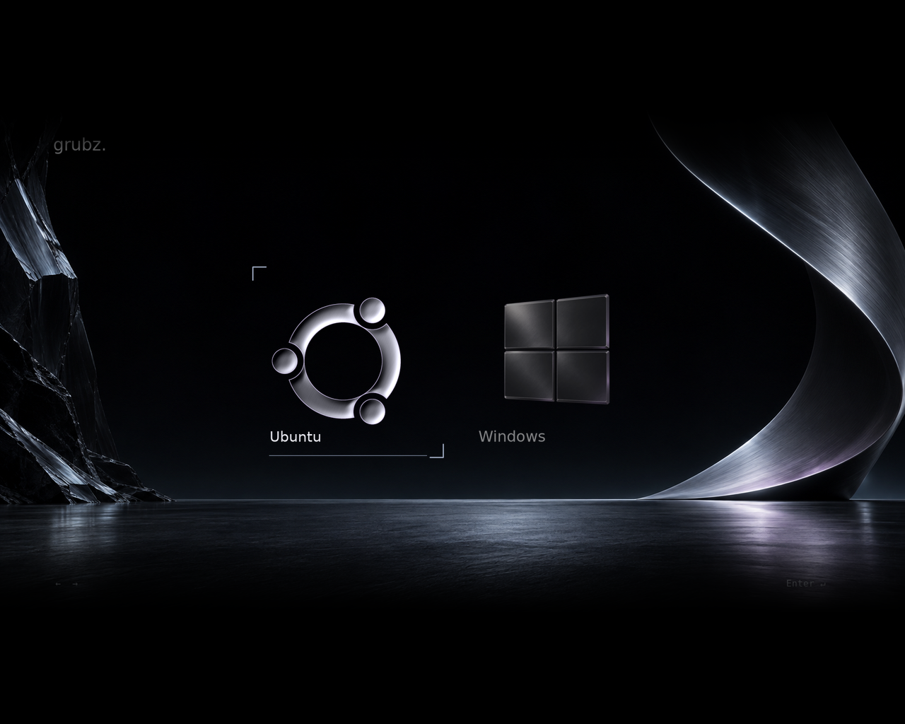
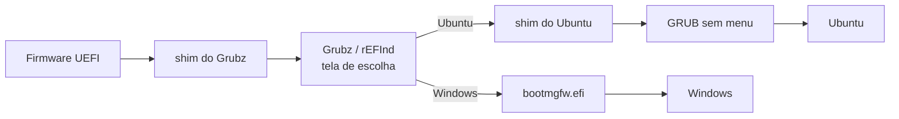

# Tela-Boot

> Tela de escolha de sistema (Ubuntu ou Windows) que aparece ao ligar o PC, com tema escuro em 1280x1024 sobre o Grubz/rEFInd e Secure Boot ligado.

  



## Sobre

O PC tem dois SSDs: Ubuntu num e Windows no outro. Este projeto deixa uma tela única de escolha logo depois do logo da placa: os dois sistemas lado a lado, setas e Enter para entrar. Ele instala o tema, a configuração do seletor [Grubz](https://github.com/Muriel-Gasparini/grubz-refind) (um rEFInd com tema próprio) e ajusta o GRUB do Ubuntu para não mostrar um segundo menu. Foi feito e testado num Dell OptiPlex 9020 com monitor 1280x1024.

## Funcionalidades

- Mostra Ubuntu e Windows lado a lado, sem rolagem, em 1280x1024 (e cabe em 1024x768).
- Entra no Ubuntu sozinho após 10 s sem escolha, para o PC voltar depois de uma queda de energia.
- Desenha um ícone cromado do Ubuntu no mesmo estilo do ícone do Windows (`gerar_tema.py`).
- Ajusta o fundo de 16:9 para 5:4 sem esticar a imagem.
- Tira o segundo menu do GRUB: escolheu Ubuntu, entra direto.
- Acha sozinho a partição EFI de cada sistema (nada de número de disco fixo no repositório).
- Mantém o shim do seletor igual ao do Ubuntu quando o `apt` atualizar o shim.
- Guarda backup antes de mexer e desfaz tudo com um comando.

## Arquitetura



O firmware abre o shim da Canonical que fica em `\EFI\grubz\`. Ele confere a assinatura do Grubz com a chave MOK registrada e o Grubz mostra a tela. Escolher Ubuntu carrega o shim e o GRUB normais do Ubuntu, que entra direto no sistema. Escolher Windows carrega o gerenciador de boot do Windows no outro SSD, sem tocar em nada dele.

## Requisitos

**Hardware**
- PC com UEFI (testado: Dell OptiPlex 9020, BIOS A05, Intel HD 4600, monitor 1280x1024).
- Ubuntu e Windows instalados, cada um com a sua partição EFI.

**Software**
- Ubuntu 26.04 com `efibootmgr` e `update-grub`.
- Grubz já instalado em `/boot/efi/EFI/grubz/` (`shimx64.efi`, `mmx64.efi`, `grubx64.efi` assinado) e entrada `Grubz` no firmware. Para compilar, assinar e registrar a chave MOK, siga o [guia do Grubz](https://github.com/Muriel-Gasparini/grubz-refind/blob/grubz/grubz/SHIM-MOK.md).
- Para refazer o tema: Python 3 com Pillow (`python3-pil`) e a fonte DejaVu Sans (`fonts-dejavu-core`).

> [!IMPORTANT]
> As chaves MOK que assinam o Grubz não ficam neste repositório. Nunca as publique.

## Instalação

1. Clone o repositório:

   ```bash
   git clone https://github.com/VituColombo0/Tela-Boot.git
   ```

2. Rode o instalador (pede a senha do sudo):

   ```bash
   cd Tela-Boot && sudo bash instalar.sh
   ```

   Ele faz backup em `backup/` (só na primeira vez), copia o tema e o `refind.conf` para `/boot/efi/EFI/grubz/`, cria `/etc/default/grub.d/50-grubz.cfg`, roda `update-grub`, instala o gancho `/etc/apt/apt.conf.d/99grubz-shim` e põe o Grubz em primeiro na ordem de boot.

3. Reinicie.

Se o PC tiver mais de duas partições EFI, diga quais usar:

```bash
sudo ESP_UBUNTU=<PARTUUID-DO-UBUNTU> ESP_WINDOWS=<PARTUUID-DO-WINDOWS> bash instalar.sh
```

Os PARTUUIDs aparecem em `lsblk -o NAME,PARTUUID,PARTTYPE`.

## Uso

Ao ligar o PC:

| Tecla | O que faz |
|-------|-----------|
| Setas esquerda/direita | Troca entre Ubuntu e Windows |
| Enter | Entra no sistema destacado |
| (nada por 10 s) | Entra no Ubuntu |

Para voltar ao estado de antes da instalação:

```bash
sudo bash desfazer.sh
```

## Configuração

O arquivo [refind.conf](refind.conf) vai para a partição EFI com os marcadores `@ESP_UBUNTU@` e `@ESP_WINDOWS@` trocados pelo instalador.

| Opção | Valor | Por quê |
|-------|-------|---------|
| `timeout` | `10` | Entra no Ubuntu sozinho após 10 s |
| `default_selection` | `Ubuntu` | Sistema destacado ao abrir |
| `resolution` | `1280 1024` | Resolução nativa do monitor |
| `big_icon_size` | `256` | Os dois ícones cabem lado a lado também em 1024x768 |
| `selection_animation_ms` | `0` | A animação de deslizar trava o seletor nesta Dell |
| `scanfor` | `manual` | Só as duas entradas do arquivo, sem procurar outros sistemas |

Para refazer o tema a partir das imagens originais do Grubz (pasta `grubz/theme` do repositório dele):

```bash
python3 gerar_tema.py <pasta-grubz/theme> theme
```

```bash
python3 previa.py theme docs/img/previa.png
```

O `previa.py` desenha a tela com a mesma conta de posição do `refind/menu.c`, para conferir o visual sem reiniciar.

## Estrutura do projeto

```
Tela-Boot/
├── instalar.sh       # instala tema, configuração, ajuste do GRUB e gancho do apt
├── desfazer.sh       # volta tudo a partir de backup/
├── refind.conf       # configuração do seletor (com marcadores das partições)
├── gerar_tema.py     # gera ícones 256 px, seleção e fundo 1280x1024
├── previa.py         # simula a tela final
├── theme/            # imagens prontas que vão para a partição EFI
└── docs/img/         # prévia usada neste README
```

## Solução de problemas

| Sintoma | Causa | Correção |
|---------|-------|----------|
| A tela aparece mas trava ao apertar uma seta (nem entra sozinho no Ubuntu) | Animação de deslizar do Grubz trava neste firmware | Manter `selection_animation_ms 0` |
| Só um ícone por vez, com rolagem | Ícones grandes demais para a resolução (384 px em 1024 de largura) | `big_icon_size 256` |
| Escolhe Ubuntu e aparece outro menu do GRUB | `os-prober` achou o Windows e forçou o menu | O instalador cria `50-grubz.cfg` com `GRUB_DISABLE_OS_PROBER=true` |
| F2/F12 não respondem no logo da Dell | Teclado USB ainda não iniciado pelo firmware | Reinicie no botão e aperte F12 de novo; em último caso, BIOS > POST Behavior > Fastboot > Thorough |
| Precisa investigar o seletor | — | Ponha `log_level 3` no `refind.conf`: o log sai em `/boot/efi/EFI/grubz/refind.log`. Se desligar no botão, o arquivo fica vazio; o texto pode ser recuperado com `sudo strings -el /dev/<particao-efi>` |
| O seletor não abre de jeito nenhum | Grubz com problema | F12 no logo da Dell e escolha Ubuntu; depois `sudo bash desfazer.sh` ou tire o Grubz da frente com `efibootmgr -o` |

## Equipe

Desenvolvido por Victor Vieira Colombo.

## Licença

Código sob a licença [MIT](LICENSE). As imagens em `theme/` são derivadas da arte do [grubz-refind](https://github.com/Muriel-Gasparini/grubz-refind) (fundo, ícone do Windows e moldura de seleção) e seguem os termos daquele projeto. Ubuntu e Windows são marcas dos seus donos; os nomes só identificam as opções de boot.
